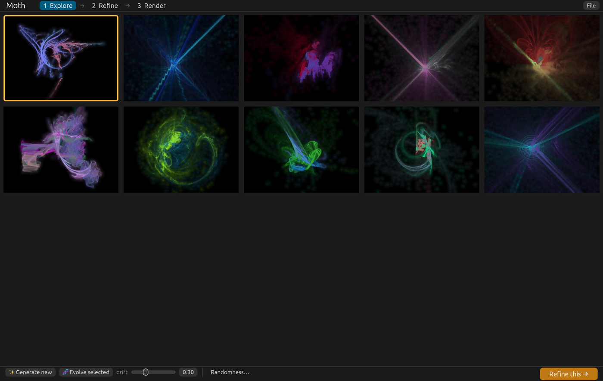
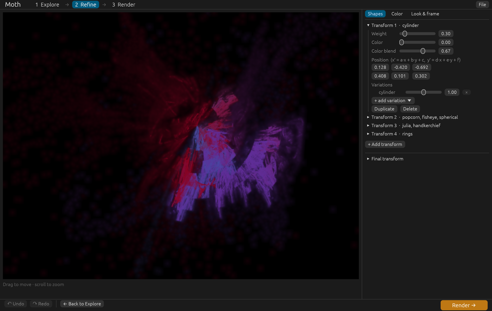
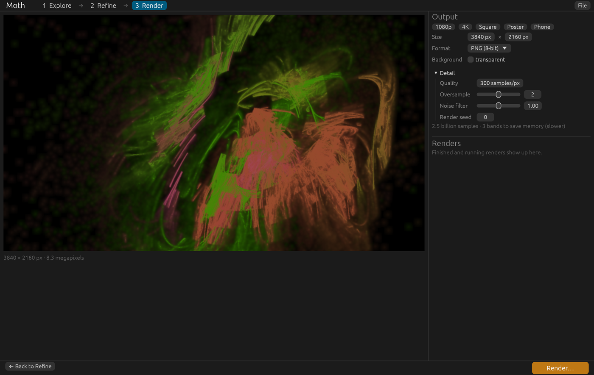

# Moth

A modern take on [Apophysis](https://en.wikipedia.org/wiki/Apophysis_(software)): explore
random fractal flames, refine the one you like, and render it at any size. Written in Rust.

> **Status: early.** The flame explorer works end to end (app, command line, file formats), but
> there is no release yet. See [docs/PLAN.md](docs/PLAN.md) for the road to feature complete.
> Targets are macOS (Apple Silicon) and Windows (x64); so far it is developed and tested on macOS.



Moth works as three stages, so only what you need for the current job is on screen:

1. **Explore:** a gallery of ten random flames. Pick one, or evolve it into ten relatives.
2. **Refine:** work on the one flame with a live preview.
3. **Render:** choose a size and format, and queue the render.

Every image Moth writes carries its own recipe, so you can open the picture later and render it
again bigger and cleaner.

## Contents

- [Build and run](#build-and-run)
- [Using the app](#using-the-app)
- [The command line](#the-command-line)
- [Files and formats](#files-and-formats)
- [Rendering: quality, size and time](#rendering-quality-size-and-time)
- [Project layout](#project-layout)
- [Development](#development)
- [Known limitations](#known-limitations)
- [License](#license)
- [Credits](#credits)

## Build and run

You need a recent stable [Rust](https://rustup.rs) (the project uses the 2024 edition).

```bash
git clone git@github.com:darrinland/moth.git
cd moth
cargo build --release
```

That builds two programs into `target/release/`:

| Program | What it is |
|---------|------------|
| `moth-ui` | The app. |
| `moth` | The command line tool. |

Start the app:

```bash
./target/release/moth-ui
```

## Using the app

The stepper along the top shows the three stages. **Render** and **Refine** unlock once a flame
is selected. The big button at the bottom right is always the next step.

### 1. Explore


- **Generate new** (or press `Space`) makes a fresh batch of ten. Flames that would be empty or a
  solid blob are discarded automatically.
- **Click** a flame to select it (orange outline). **Double-click** to go straight to Refine.
- **Evolve selected** (or `E`) keeps the selected flame in the first slot and fills the rest with
  mutations of it. The **drift** slider sets how far the mutations wander: low stays close, high
  is almost unrelated.
- **Randomness…** opens a drawer that steers every new batch and every evolve:
  - how many transforms, and how many variations are mixed into each,
  - **wildness**: how far transforms stretch, shear and wander,
  - the chance of a **final transform**,
  - **allowed variations**: tick or untick any of the 26 variations (with All, None and Invert).
    Unticked variations are never used by the randomizer.

### 2. Refine



The preview updates as you edit: a quick version while you drag, a finer one when you stop.

- **Drag** the preview to move the picture; **scroll** to zoom.
- **Undo / Redo** in the footer, or `Cmd+Z` and `Cmd+Shift+Z` on macOS (`Ctrl` on Windows).
- Three tabs on the right:

| Tab | What it does |
|-----|--------------|
| **Shapes** | Each *transform* is one of the functions the flame is built from. Per transform: **weight** (how often it is used), **color** and **color blend** (which palette position it paints and how strongly it pulls the color), **position** (the six affine numbers `a` to `f`, where `x′ = a·x + b·y + c`, `y′ = d·x + e·y + f`), and its **variations** (a weight for each, `×` to remove, `+ add variation` to add). You can duplicate or delete a transform and add a new one. An optional **final transform** warps the finished picture without feeding back into the shapes. |
| **Color** | A preview of the gradient and eight color stops you can edit directly (`−` and `+` change the count). **Randomize** makes a new gradient, **Reverse** flips it, **Hue** and **Slide** nudge it. Also the **background** color. |
| **Look & frame** | **Brightness**, **gamma** and **vibrancy** (low vibrancy washes colors toward pastel at high gamma; 1 keeps them vivid). **Zoom**, **rotate** and **center**, plus **Auto-frame** to center the picture and fit it in the frame. |

When you leave Refine, your edits are written back to the flame in the gallery.

### 3. Render



- The preview shows exactly what will be cropped for the shape you pick, so you can choose a
  size knowing what the framing will be.
- **Output:** size (quick buttons for 1080p, 4K, Square, Poster and Phone), **format** (PNG 8-bit,
  PNG 16-bit or JPEG), JPEG quality, and a **transparent** background for PNG.
- **Detail:** **quality** (samples per pixel), **oversample**, **noise filter** and a render
  **seed**. See [Rendering](#rendering-quality-size-and-time).
- **Render…** asks where to save, then adds the job to the **Renders** list. Jobs run one after
  another in the background; the app stays usable. Each shows its progress, how long it took and a
  **Show** button once finished.
- Very large images are rendered in horizontal bands to keep memory bounded. The panel tells you
  when that applies; it is slower, because each band replays the same samples.

### Keyboard and mouse

| Where | Input | Does |
|-------|-------|------|
| Explore | `Space` | Generate a new batch |
| Explore | `E` | Evolve the selected flame |
| Explore | Double-click a flame | Open it in Refine |
| Refine | Drag the preview | Move the picture |
| Refine | Scroll over the preview | Zoom |
| Refine | `Cmd+Z` / `Cmd+Shift+Z` (`Ctrl` on Windows) | Undo / redo |

### The File menu

- **Open…** loads a `.flame` file (which may hold many flames; they all appear in the gallery) or a
  Moth PNG or JPEG, using the recipe embedded in it.
- **Save flame…** writes the current flame as a `.flame` file.

## The command line

`moth` does everything the app does without a window: useful for batches, servers and scripts.
Run `moth --help` or `moth <command> --help` for every option.

```bash
# Ten random flames: a .png and a .flame for each, in out/
moth random

# Reproducible: flame i uses seed + i
moth random --seed 42 -n 4 --size 1280x960 -q 200 -o gallery

# Steer the randomizer
moth random --xforms 3-6 --wildness 0.8

# Ten relatives of a saved flame (or of a Moth image)
moth mutate gallery/moth-42.flame --amount 0.3 -o evolved

# Render a saved flame bigger and cleaner
moth render gallery/moth-42.flame -o big.png --size 3840x2160 -q 400

# Re-render from the recipe inside an image
moth render gallery/moth-42.png -o poster.png --size 4000x3000 -q 200 --deep

# JPEG output, chosen by the file extension
moth render gallery/moth-42.flame -o picture.jpg --jpeg-quality 95
```

Options shared by all three commands:

| Option | Meaning | Default |
|--------|---------|---------|
| `--size WxH` | Output size | `1024x768` |
| `-q, --quality N` | Samples per pixel | `100` |
| `--oversample N` | Render at N times the resolution, then average down | `2` |
| `--denoise X` | Strength of the noise filter; `0` turns it off | `1` |
| `--transparent` | Transparent background (PNG only; JPEG composites over the background) | off |
| `--deep` | Write 16-bit PNGs | off |
| `--jpeg-quality N` | JPEG quality, 1 to 100 | `92` |
| `--render-seed N` | Seed for the render itself | `0` |
| `--strip-pixels N` | Largest band to render at once, to bound memory | `16000000` |

Notes:

- `random` and `mutate` always write PNGs (plus a `.flame` beside each). Only `render` can write
  JPEG, chosen by the output file's extension (`.png` or `.jpg`).
- `render` accepts a `.flame`, or a PNG or JPEG that carries a recipe. If a `.flame` holds several
  flames, pick one with `--index` (0-based).
- If a file uses variations Moth does not know yet, `render` prints a warning naming them and
  renders without them.

## Files and formats

- **`.flame`** is the flam3 / Apophysis XML format, so flames made elsewhere open in Moth and
  Moth's open elsewhere (as far as the variations overlap). Moth reads and writes `xform`,
  `finalxform`, `post`, a 256-entry `palette`, and the usual camera and tone attributes.
  Variations Moth does not support yet are skipped and reported, never dropped silently.
- **Moth images** (PNG and JPEG) embed the flame XML: in an `iTXt` chunk named `moth.flame` for
  PNG, and in an `APP15` segment for JPEG. Open one with **File → Open…** or `moth render` to get
  the recipe back. Some tools strip this metadata when they re-save an image; keep the `.flame`
  too if the picture matters.
- A flame is stored independent of resolution, so the same file renders at any size.

## Rendering: quality, size and time

A flame is drawn by the *chaos game*: millions of points are plotted and counted per pixel.
More points means less noise.

- **Quality** is samples per pixel; total work is `quality × width × height` samples. As a rough
  guide: 50 to 100 is a draft, 300 to 1000 is a good final, and higher keeps smoothing very fine
  detail.
- **Oversample** draws at a higher resolution and averages down, which smooths edges. It costs
  memory, not extra samples.
- **Noise filter** blurs sparse, noisy areas more than dense, detailed ones, conserving the total
  light. Raise it for a smoother look at low quality; set it to `0` for the raw result.
- **Seed** changes only the random sample stream: the same flame and seed always give the same
  image.
- **Time:** the renderer currently runs on the CPU, at tens of millions of samples per second on a
  recent laptop. A 4K image at quality 300 is about two and a half billion samples. A GPU
  renderer is planned.
- **Huge images** are rendered in bands and streamed to disk, so they fit in memory, but take
  proportionally longer.

## Project layout

```
crates/
  moth-core/   The library: generators, the flame model and renderer, file formats, export.
    flame/       genome, variations, random and mutate, renderer, palette, .flame I/O
    generator.rs the Generator trait and render types
    export.rs    render straight to a file; load a flame from a file or image
    output.rs    PNG and JPEG writing, embedded recipes
  moth-cli/    The `moth` command line tool.
  moth-ui/     The `moth-ui` app (egui): stages, worker threads, export queue, self-test.
docs/
  PLAN.md      The implementation plan.
  images/      Screenshots used in this README.
```

`moth-core` has no UI dependency. The app and the command line are thin layers over it.

## Development

```bash
cargo test                 # unit tests
cargo fmt --all --check    # formatting
cargo clippy --all-targets # lints
```

**App self-test.** The app can drive itself through every stage, check a few behaviors (such as
undo restoring a flame exactly) and save screenshots of its own window, then quit:

```bash
MOTH_SMOKE=out/smoke ./target/release/moth-ui
```

The window opens off screen and inactive, and on macOS the app runs as an accessory app, so the
self-test never takes focus from your other work. It prints `SMOKE ok` or `SMOKE FAIL` lines and writes numbered PNGs to the folder. It captures only
Moth's own window, never the desktop. The window stays on top while it runs.

## Known limitations

- Only 26 of the paper's variations exist so far, and none are parametric yet. See the plan for
  the full list and order.
- Brightness and gamma are Moth's own scaling, so an imported flame will not look pixel-identical to
  Apophysis yet.
- The renderer runs on the CPU only. A GPU renderer is required for 1.0 and is planned.
- Faint blurry specks can appear in the dark areas of some flames.
- No history or favorites yet: the gallery is not saved between runs. Save a `.flame` or export an
  image to keep one. (History is designed in the plan.)

## License

Moth is released under the [MIT License](LICENSE).

## Credits

The algorithm and its conventions come from Scott Draves and Erik Reckase, *The Fractal Flame
Algorithm* ([flam3.com/flame_draves.pdf](https://flam3.com/flame_draves.pdf)). The variation
formulas are checked against that paper by a test in `moth-core`. Moth is a clean-room
implementation: no Apophysis or flam3 source code is used.
